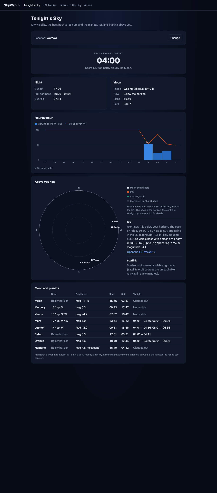
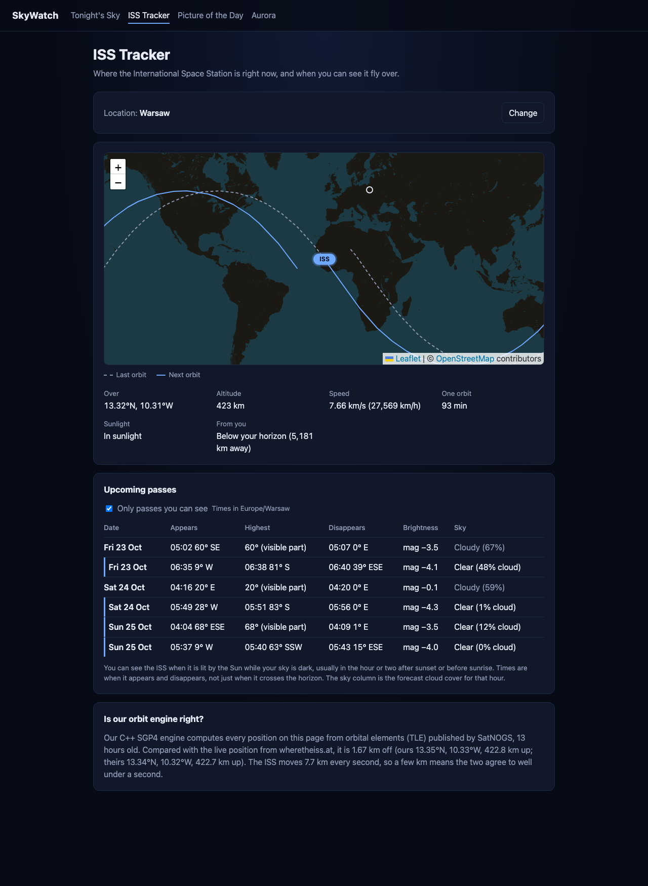
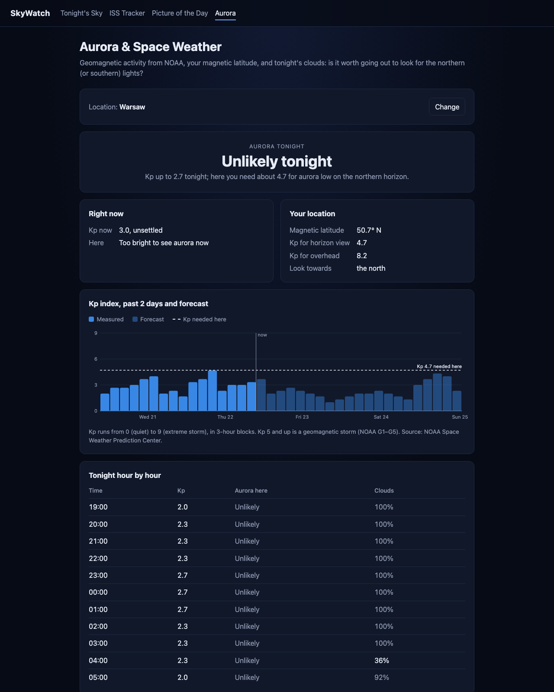
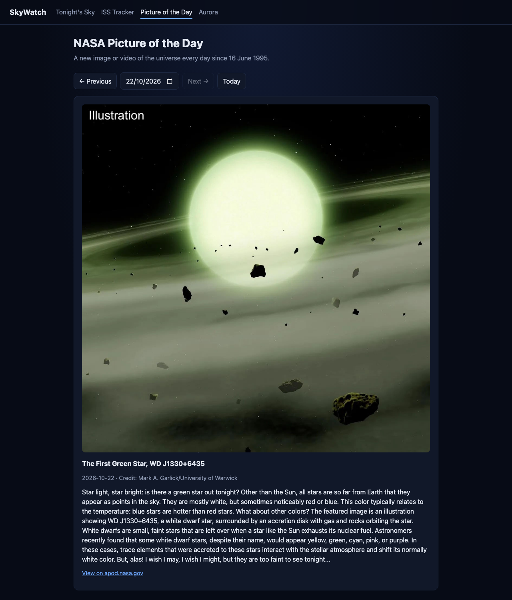

# SkyWatch

What can you see in the sky tonight? SkyWatch is a C++ web app that answers that for any place on Earth. It shows when the sky is clearest, which planets are up, when the International Space Station flies over, where the Starlink satellites are, NASA's picture of the day, and whether aurora is likely.

All the astronomy runs in C++ without an astronomy library. That includes Sun, Moon and planet positions, an SGP4 satellite orbit propagator, pass prediction, and Earth's shadow. The browser only draws what the server computes.



## Screens

| Screen | What it shows |
|---|---|
| **Tonight's Sky** (`/`) | A one-line verdict for the night ("A poor night in Cairo, but the sky clears 20:00–03:00"), the whole-night rating (%), best hour and Moon, a chart of the night (how high each planet climbs per hour, with cloud haze, cloud % and viewing score under each hour), a card per planet with its best hour, an hour-by-hour visibility grid, a live sky dome (Moon, planets, ISS, Starlink), the next visible ISS pass and Starlink counts |
| **ISS Tracker** (`/iss.html`) | Live map with the ground track, speed and altitude, where to look from your location, visible passes for the next 3 days, and a live check of our orbit engine against wheretheiss.at |
| **Picture of the Day** (`/apod.html`) | NASA's Astronomy Picture of the Day, with a date picker back to 1995 |
| **Aurora** (`/aurora.html`) | Kp index (measured and forecast), your geomagnetic latitude, the Kp you need, and tonight hour by hour with clouds |

| ISS Tracker | Aurora | Picture of the Day |
|---|---|---|
|  |  |  |

Pick a location by searching for a city, clicking the map, or using your browser's location. It is remembered across screens. A link such as `/?lat=52.23&lon=21.01&name=Warsaw` sets it directly.

## Build and run

You need a C++17 compiler, CMake 3.20+ and OpenSSL (`brew install cmake openssl` on macOS). The other libraries (cpp-httplib, nlohmann/json, doctest) are downloaded by CMake.

```sh
cp config.example.json config.json   # then put your NASA API key in it
cmake -S . -B build -DCMAKE_BUILD_TYPE=Release
cmake --build build -j
./build/skywatch                       # open http://localhost:8080
./build/skywatch_tests                 # unit tests
```

`config.json` holds the port and the NASA API key. `DEMO_KEY` works but allows only 30 requests an hour; a personal key is free at <https://api.nasa.gov>.

## Data sources

| API | Used for | Key | Cached |
|---|---|---|---|
| [Open-Meteo forecast](https://open-meteo.com) | Hourly cloud layers, visibility, humidity, rain | no | 30 min |
| [Open-Meteo geocoding](https://open-meteo.com/en/docs/geocoding-api) | City search | no | 24 h |
| [CelesTrak](https://celestrak.org) | ISS and Starlink orbits (TLEs) | no | 6 h, on disk |
| [SatNOGS DB](https://db.satnogs.org) | Fallback ISS orbit when CelesTrak is unreachable | no | 6 h, on disk |
| [NASA APOD](https://api.nasa.gov) | Picture of the day | yes | 24 h (today: 1 h) |
| [NOAA SWPC](https://www.swpc.noaa.gov) | Kp index, now and 3-day forecast | no | 15 min |
| [wheretheiss.at](https://wheretheiss.at) | Only to check our ISS position | no | 4 s |

TLEs are cached on disk in `cache/` because CelesTrak blocks clients that download the same data more than once every 2 hours. If a download fails, the last good copy is used.

## REST API

| Endpoint | Returns |
|---|---|
| `GET /api/geocode?q=Warsaw` | Matching places |
| `GET /api/sky?lat=&lon=` | Hourly sky condition and viewing score, best hour, whole-night rating, twilight times, Moon |
| `GET /api/planets?lat=&lon=` | Moon and planets: position, magnitude, rise/set, clear-sky windows tonight, hourly visibility score and best hour |
| `GET /api/iss/now[?lat=&lon=][&check=1]` | ISS position, speed, sunlight; look angles for an observer; comparison with wheretheiss.at |
| `GET /api/iss/track?minutes=95` | Ground track around now |
| `GET /api/iss/passes?lat=&lon=&days=3` | Passes, with the visible part and brightness |
| `GET /api/starlink?lat=&lon=` | Counts above the horizon, sunlit and visible; newest launches; positions |
| `GET /api/aurora?lat=&lon=` | Kp now and forecast, Kp needed here, tonight hour by hour |
| `GET /api/apod?date=YYYY-MM-DD` | Picture of the day |

## How it works

```
src/
  main.cpp            routes
  http/               HTTPS client and TTL cache
  apis/               one client per external API
  astro/              the astronomy engine (no external library)
    time, coords      Julian dates, sidereal time, equatorial/horizontal, TEME/ECEF/WGS-84, Earth's shadow
    sun_moon          Sun and Moon (Meeus ch. 25, 47, 48), rise/set and twilight search
    planets           JPL Keplerian elements, Kepler's equation, light time, precession, magnitudes
    tle, sgp4         TLE parsing and the SGP4 propagator (Vallado et al. 2006, near-Earth)
    passes            pass prediction, visibility (sunlit satellite, dark sky), brightness
  services/           combine astronomy and API data into the JSON each screen needs
web/                  static HTML/CSS/JS, Leaflet maps, SVG charts, canvas sky dome
tests/                doctest unit tests
```

**Viewing score (0–100), per hour:** zero while the Sun is above −6°. Otherwise it starts from 100 × the fraction of sky clear of cloud, where the cloud layers block light independently and thin high cloud counts half. Haze, humidity over 85%, rain chance and a Moon above the horizon each subtract points. The result is scaled by darkness: half at −6°, full at −18° (astronomical night).

**Whole-night rating (%):** the average viewing score over the dark hours (Sun below −6°), shown with how many of those hours are clear or mostly clear.

**When to see each body (0–100, per hour):** 100 × altitude factor (40% at 10° up, full from 40°) × darkness (bright bodies count from early twilight: Venus with the Sun 3° down, a magnitude 2 planet only at −18°) × clear sky (0 when clouds block half the sky or more) × moonlight (dims only bodies fainter than magnitude 3). The best hour is the highest score still ahead.

**Planet visibility tonight:** hours when the body is at least 10° up, the Sun is below −6°, and the forecast is mostly clear (clouds block less than half the sky).

**Aurora:** geomagnetic latitude comes from the dipole model (pole at 80.8°N, 72.8°W). As a rule of thumb, the oval's edge sits at about 67° − 2·Kp, and aurora shows low on the horizon up to 7° beyond it. Tonight's rating combines the Kp forecast, darkness (Sun below −12°) and clouds.

## Accuracy

| What | Checked against | Result |
|---|---|---|
| SGP4 | Vallado's official verification vectors (all 9 near-Earth cases, 126 time steps) | within 1 m and 1 mm/s |
| ISS position | wheretheiss.at, live | about 1.6 km apart (their TLE is older; the ISS travels 7.7 km/s) |
| ISS passes | PyEphem with the same TLE, 3 days over Warsaw | rise, peak and set within about 1 s |
| Sun and Moon | Meeus's worked examples; PyEphem for 5 cities × 5 dates | rise/set within 15 s, positions within 0.02° |
| Planets | Meeus example 33.a; PyEphem for 3 cities × 5 dates | positions within 0.08°, rise/set within 30 s |

## Limitations

- SGP4 is near-Earth only (orbits under 225 minutes). That covers the ISS and every Starlink satellite, but not GPS or geostationary satellites.
- Starlink orbits come only from CelesTrak. If it is unreachable and nothing is cached, the Starlink card says so and the rest of the page still works.
- Planet magnitudes for Mercury and Venus use Mallama & Hilton (2018), the formulas the Astronomical Almanac uses. Other tools may differ by up to half a magnitude near the Sun.
- The aurora rating is a rule of thumb, not NOAA's OVATION model.
